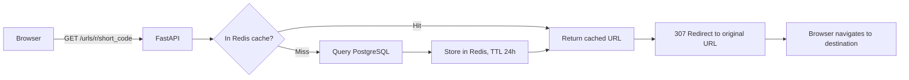

# FastURL

A URL shortening service built with FastAPI, PostgreSQL, and Redis — with JWT auth, rate limiting, and a Redis caching layer.

Originally forked from [nglong14/FastURL](https://github.com/nglong14/FastURL), then extended with bug fixes, a working redirect flow, database indexing verification, load testing, and measured performance numbers (details below).

---

## Features

- Shorten long URLs into short, shareable codes
- Redirect short codes to their original URL (HTTP 307)
- Redis caching for low-latency lookups (cache-aside pattern)
- Click tracking, synced from Redis to PostgreSQL in the background
- JWT-based user authentication
- Rate limiting on write endpoints (`slowapi`)
- Auto-generated API docs (Swagger UI)

---

## How a redirect request flows through the system



A cache hit skips PostgreSQL entirely. A cache miss falls back to the database, then populates the cache for next time. Click counts are incremented in Redis instantly and synced to PostgreSQL as a background task, so the redirect itself never waits on a database write.

---

## Measured performance

These numbers come from actually testing this project — not estimates. Methodology for each is in the project's write-up; happy to walk through any of it.

| What was tested | Result |
|---|---|
| Redis cache vs. no cache (lookup latency) | **33% faster** — 10.1ms average → 6.7ms average |
| Indexed DB lookup vs. sequential scan (50,000-row table, `EXPLAIN ANALYZE`) | **85% faster** — 4.9ms → 0.7ms |
| Load test, 20 concurrent users (Locust) | 16 req/sec, 19ms median, 290ms p99 latency |
| Load test, 100 concurrent users | 33 req/sec, 21ms median, 480ms p99 latency |
| Load test, 300 concurrent users | 87 req/sec, 220ms median, 2.1s p99 latency |

**Note on the 300-user result:** latency grows noticeably at this concurrency level. This lines up with running a single Uvicorn worker process (`--reload` mode) and SQLAlchemy's default connection pool (5 connections + 10 overflow = 15 total) — both are development-mode defaults, not production configuration. In a production deployment, multiple worker processes and a larger connection pool would be the first things to tune.

---

## Tech Stack

| Layer | Choice |
|---|---|
| Backend | FastAPI (Python 3.11) |
| Database | PostgreSQL |
| Cache | Redis |
| ORM | SQLAlchemy 2.0 |
| Auth | JWT (`PyJWT`) |
| Rate limiting | `slowapi` |
| Load testing | Locust |
| Containers | Docker + Docker Compose |

---

## Getting Started

### Prerequisites
- Python 3.11+
- Docker & Docker Compose

### 1. Clone and set up a virtual environment

```bash
git clone <your-fork-url-here>
cd FastURL

python -m venv .venv
.venv\Scripts\activate      # Windows
# source .venv/bin/activate   # macOS/Linux

pip install -r requirements.txt
```

For running tests, seeding sample data, or load testing, install dev dependencies instead:
```bash
pip install -r requirements-dev.txt
```

### 2. Create your `.env` file

```env
DATABASE_USERNAME=your_db_username
DATABASE_PASSWORD=your_db_password
DATABASE_NAME=your_db_name
REDIS_PASSWORD=your_redis_password
SECRET_KEY=your_generated_secret_key
ALGORITHM=HS256
ACCESS_TOKEN_EXPIRE_MINUTES=30
```

Generate a `SECRET_KEY` with:
```bash
python -c "import secrets; print(secrets.token_hex(32))"
```

### 3. Start everything with Docker Compose

```bash
docker-compose up --build
```

This starts PostgreSQL, Redis, and the FastAPI app, and creates the database tables automatically.

- App: `http://localhost:8000`
- Interactive API docs: `http://localhost:8000/docs`

---

## API Endpoints

### Users & Auth
```
POST /users/        # Create a new user
GET  /users/{id}    # Get a user by ID
POST /login          # Log in, returns a JWT access token
```

### URLs
```
POST /urls/               # Create a short URL (auth required)
GET  /urls/                # List your own URLs (auth required)
GET  /urls/r/{short_code}  # Redirect to the original URL
```

### Health
```
GET /health
```

---

## Running Tests

The project includes a pytest suite with an isolated test database and a separate Redis database (db 15) so tests never touch real data.

```bash
pip install -r requirements-dev.txt
pytest test/ -v
```

---

## Seeding Sample Data

To generate realistic test data (5,000 users, 50,000 URLs) for benchmarking or load testing:

```bash
python fake.py
```

## Load Testing

```bash
locust -f locust.py --host=http://localhost:8000
```

Then open `http://localhost:8089`, set your desired user count and spawn rate, and start the test.

---

## Project Structure

```
FastURL/
├── backend/
│   ├── routers/
│   │   ├── auth.py
│   │   ├── users.py
│   │   └── url.py
│   ├── models.py
│   ├── database.py
│   ├── config.py
│   ├── oauth2.py
│   ├── utils.py
│   ├── cache.py
│   └── main.py
├── test/
│   ├── conftest.py
│   └── test_url.py
├── fake.py              # Seed script for sample data
├── locust.py             # Load testing scenarios
├── Dockerfile
├── docker-compose.yml
├── requirements.txt
├── requirements-dev.txt
└── README.md
```