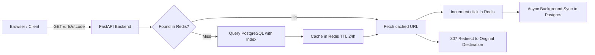

# FastURL

A high-performance, full-stack URL shortening and link analytics platform built with **FastAPI**, **PostgreSQL**, **Redis**, and **Next.js 16**.

Features JWT authentication, cache-aside lookups with sub-7ms latency, background click synchronization, rate limiting, and an App Router web dashboard with dark/light mode.

---

## Features

- **Shorten & Share:** Instantly turn long URLs into clean, 6-character short codes with collision resistance.
- **Ultra-Low Latency Redirects:** HTTP 307 temporary redirects with a Redis cache-aside layer (sub-7ms response times).
- **Background Click Tracking:** Clicks are incremented immediately in Redis and synced to PostgreSQL asynchronously without delaying the redirect response.
- **Modern Web Dashboard:** Full-stack UI built with Next.js 16, React 19, Tailwind CSS v4, and top navigation.
- **Complete URL Management:** Create, search, copy, test redirects, and delete links with real-time updates.
- **JWT Authentication:** OAuth2 password flow with signed bearer tokens and user-scoped data access.
- **Security Built-In:** Enforced HTTP/HTTPS URL validation, password complexity constraints, and endpoint rate limiting (`slowapi`).
- **CI/CD Automation:** GitHub Actions pipeline validating backend tests, Docker container builds, and frontend typechecking.
- **Interactive API Documentation:** Auto-generated Swagger UI and OpenAPI specifications.

---

## How a Redirect Request Flows



A cache hit resolves directly from memory. A cache miss queries PostgreSQL using indexed lookups, then populates the cache for subsequent requests. Click counts increment instantly in Redis and synchronize to PostgreSQL via isolated background tasks, so redirects never wait on database disk writes.

---

## Measured Performance

These benchmarks reflect actual load testing and profiling conducted on this codebase:

| Metric | Result | Benchmark Details |
|---|---|---|
| **Redis cache vs. no cache** | **33% faster** | 10.1ms average latency → 6.7ms average latency |
| **Indexed DB lookup vs. sequential scan** | **85% faster** | 4.9ms → 0.7ms (`EXPLAIN ANALYZE` on 50,000 rows) |
| **Concurrency: 20 concurrent users (Locust)** | **16 req/sec** | 19ms median latency, 290ms p99 |
| **Concurrency: 100 concurrent users** | **33 req/sec** | 21ms median latency, 480ms p99 |
| **Concurrency: 300 concurrent users** | **87 req/sec** | 220ms median latency, 2.1s p99 |

---

## Tech Stack

| Layer | Technology | Details |
|---|---|---|
| **Frontend** | Next.js 16, React 19, TypeScript | App Router, Tailwind CSS v4, SWR, Lucide Icons |
| **Backend** | FastAPI (Python 3.11+) | Asynchronous & threadpool endpoints, Pydantic v2 |
| **Database** | PostgreSQL 15 | Indexed foreign keys, SQLAlchemy 2.0 ORM |
| **Cache & Buffering** | Redis 7 | Cache-aside pattern, atomic click counters, timeouts |
| **Authentication** | JWT (`PyJWT`) & `pwdlib` | OAuth2 password bearer tokens, Argon2/Bcrypt |
| **Rate Limiting** | `slowapi` | Per-endpoint IP throttles |
| **Testing & QA** | `pytest`, `httpx`, Locust | Automated CI test suites, data fixtures, load testing |
| **DevOps & Containers** | Docker & GitHub Actions | Multi-stage Dockerfile, Docker Compose, automated CI |

---

## Getting Started

### Prerequisites
- [Docker & Docker Compose](https://www.docker.com/)
- [Node.js 20+](https://nodejs.org/) & [pnpm](https://pnpm.io/) (for frontend)
- [Python 3.11+](https://www.python.org/) or [`uv`](https://docs.astral.sh/uv/) (optional for local backend development)

---

### Step 1: Clone and Configure Environment

```bash
git clone https://github.com/OmeshGupta123/FastURL-optimized_url_shortner.git
cd FastURL
```

Copy the environment templates:

```bash
# Backend environment
cp .env.example .env

# Frontend environment
cp frontend/.env.example frontend/.env.local
```

You can generate a secure `SECRET_KEY` for `.env` with:
```bash
python -c "import secrets; print(secrets.token_hex(32))"
```

---

### Step 2: Start the Backend (All Services in Docker)

Run all backend services (PostgreSQL, Redis, and FastAPI) in one command:

```bash
docker compose up -d
```

- **API Base:** `http://localhost:8000`
- **Swagger Interactive Docs:** `http://localhost:8000/docs`
- **Health Check:** `http://localhost:8000/health`

---

### Step 3: Start the Next.js Frontend

In a second terminal:

```bash
cd frontend
pnpm install
pnpm dev
```

Open **[`http://localhost:3000`](http://localhost:3000)** in your browser to start creating short links.

---

## API Reference

### Authentication & Users
| Method | Endpoint | Description | Auth Required |
|---|---|---|---|
| `POST` | `/users/` | Register a new user account | No |
| `POST` | `/login` | Log in with form credentials, returns JWT | No |
| `GET` | `/users/me` | Fetch authenticated user profile | **Yes** (Bearer) |
| `GET` | `/users/{id}` | Fetch user profile by ID (own account only) | **Yes** (Bearer) |

### URLs & Analytics
| Method | Endpoint | Description | Auth Required |
|---|---|---|---|
| `POST` | `/urls/` | Shorten a destination URL | **Yes** (Bearer) |
| `GET` | `/urls/` | List all URLs for the logged-in user | **Yes** (Bearer) |
| `DELETE`| `/urls/{id}` | Delete a short URL & invalidate caches | **Yes** (Bearer) |
| `GET` | `/urls/r/{short_code}` | Public 307 redirect to destination | No |

### Health
| Method | Endpoint | Description | Auth Required |
|---|---|---|---|
| `GET` | `/health` | Service health check | No |

---

## Running Tests

### Backend Tests (pytest)
Runs against dedicated test containers with automatic schema creation and teardown:

```bash
pytest test/ -v
```

### Frontend Typechecking & Build
```bash
cd frontend
pnpm exec tsc --noEmit
pnpm build
```

---

## Benchmarking & Data Generation

### Seed Sample Data
To populate the database with 5,000 users and 50,000 URLs:
```bash
python fake.py
```

### Run Locust Load Tests
```bash
locust --host=http://localhost:8000
```
Open `http://localhost:8089` to configure concurrent users and monitor throughput and latency percentiles.

---

## Project Structure

```
FastURL/
├── .github/
│   └── workflows/
│       └── ci.yml               # Automated CI pipeline (Backend, Docker, Frontend)
├── backend/
│   ├── routers/
│   │   ├── auth.py              # Login endpoint
│   │   ├── users.py             # User signup, /me, and profile
│   │   └── url.py               # Create, list, delete, redirect
│   ├── cache.py                 # Redis connection and helper functions
│   ├── config.py                # Environment and pydantic settings
│   ├── database.py              # SQLAlchemy engine and session factory
│   ├── main.py                  # FastAPI app and lifespan startup
│   ├── models.py                # SQLAlchemy ORM models (indexed)
│   ├── oauth2.py                # JWT creation, verification, and dependencies
│   ├── schemas.py               # Pydantic validation schemas
│   └── utils.py                 # Password hashing utilities
├── frontend/
│   ├── app/
│   │   ├── (site)/              # Public landing page sections
│   │   ├── dashboard/           # Authenticated user dashboard and creation views
│   │   ├── login/               # Sign-in page
│   │   └── register/            # Sign-up page
│   ├── components/              # UI components, dashboard shell, navigation
│   ├── hooks/                   # Custom SWR hooks (useUrls, useCreateUrl)
│   ├── lib/                     # API client, auth provider, and validation
│   └── package.json             # Next.js 16, React 19, Tailwind CSS v4
├── test/
│   ├── conftest.py              # Test database and client fixtures
│   └── test_url.py              # URL and authentication tests
├── .env.example                 # Root environment template
├── docker-compose.yml           # PostgreSQL, Redis, and FastAPI orchestration
├── Dockerfile                   # Production container definition
├── fake.py                      # Data generation script
├── locustfile.py                # Load test scenarios
├── pyproject.toml               # Python project configuration
├── requirements.txt             # Pinned backend dependencies
└── README.md                    # Project documentation
```
